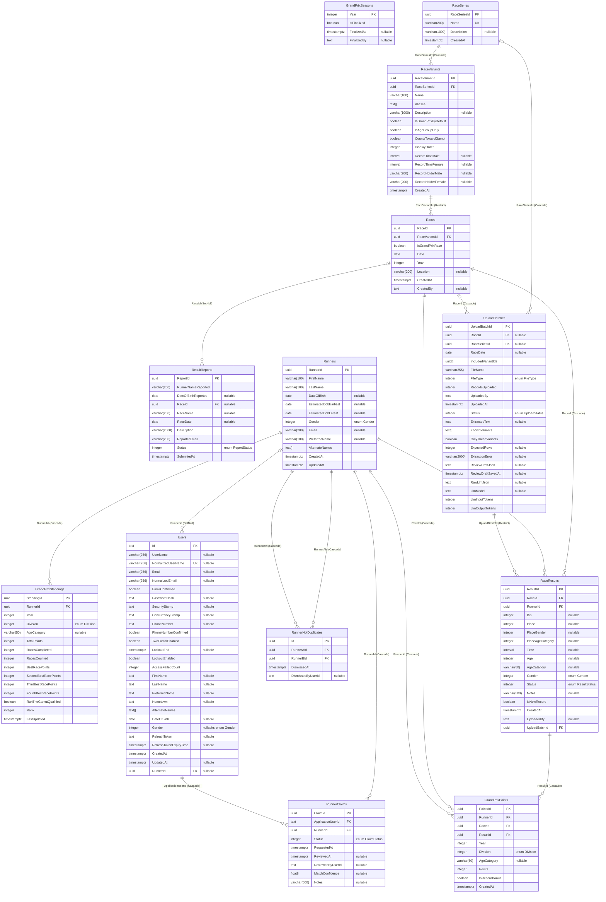

# Database ERD

<!-- Generated from the EF Core model by AmrGrandPrix.API.Tests/Infrastructure/ErdGenerator.cs. Do not edit by hand. -->

PostgreSQL schema as built by EF Core migrations. ASP.NET Identity's role/claim/login/token tables are omitted.
Regenerate after changing the model:

```bash
UPDATE_ERD=1 dotnet test --filter "FullyQualifiedName~ErdTests"
```

Relationship labels name the foreign-key column(s) and delete behavior.


